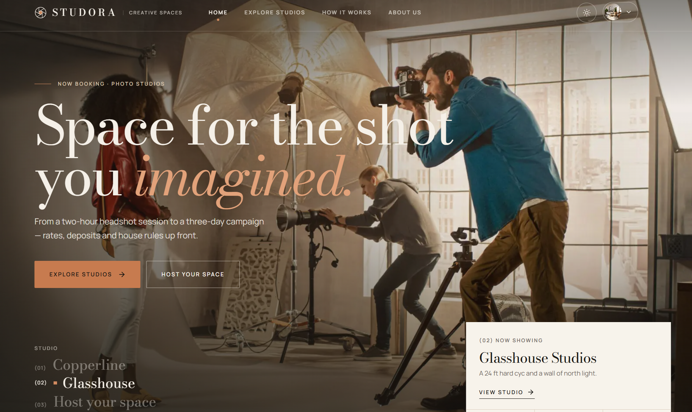

# 🎬 Studora — Creative Studio Booking Marketplace

A responsive studio booking website built with **Next.js App Router, TypeScript, Tailwind CSS, shadcn/ui, Better Auth, MongoDB** and a separate **Express.js** server.

**Studora** is a place where creators can find and book creative spaces by the hour — photo studios, film stages, podcast rooms, music suites and more. Hosts can list their own studio, manage their listings and confirm the bookings they receive.

---

## 🌐 Live Demo

🔗 **Live Website:** https://studora-chi.vercel.app/

🔗 **Client Repository:** https://github.com/Sadekul21/studora

🔗 **Server Repository:** https://github.com/Sadekul21/studora-server

---

## 🔑 Test Credentials

This host account owns the demo studios, so you can see booking requests, confirm them and manage listings.

| Role | Email | Password |
| --- | --- | --- |
| Host | host@studora.com | Host1234 |

You can also create your own account or continue with Google to book a studio.

---

## 📸 Project Preview



---

## 📖 About the Project

Studora has two sides — creators who need a space and hosts who have one.

Creators can explore studios by category, location, price and capacity, open a studio to see its gallery, specifications, amenities and host, and then book it for specific hours on a date. Every new booking is saved as **Pending**. After that it can become **Confirmed**, **Completed** or **Cancelled**.

Hosts can add a studio with photos, update or delete their listings, and confirm or decline the requests that come in. Once a booking is confirmed, those hours are locked, so the same time can't be booked twice.

The frontend is built with Next.js and the backend is a separate Express.js REST API. Both use the same MongoDB database and are deployed on Vercel.

I built this project as part of my learning journey in full-stack web development, focusing on Next.js App Router, TypeScript, building a REST API with Express, authentication with Better Auth, JWT-protected routes, MongoDB, reusable components, responsive design and deployment.

---

## ✨ Features

- 🎬 **Hero Slider** — Full-screen slider with three featured spaces and autoplay.
- ⭐ **Featured Studios** — The six top-rated studios on the home page.
- 🗂️ **Studio Categories** — Eight categories; clicking one opens the explore page with that category selected.
- 🔎 **Search, Filter & Sort** — Search studios and filter by category, location, price and capacity, then sort by price or rating.
- 🏠 **Studio Details** — Specifications, photo gallery, amenities, host information, ratings and similar studios.
- 📅 **Book Workspace** — A booking modal with a calendar, hourly time slots, crew size, a note for the host and the total price.
- 🚫 **No Double Booking** — Hours that are already confirmed are blocked, and the server rejects any overlapping booking.
- 🧾 **My Bookings** — All bookings with Pending, Confirmed, Completed and Cancelled status badges.
- ❌ **Cancel Booking** — Pending bookings can be cancelled from a confirmation modal.
- 📊 **Dashboard** — Stats, a six-month earnings chart, the next upcoming booking and booking requests to confirm or decline.
- ➕ **Add Studio** — A studio form with image upload (imgbb), amenities and a live preview.
- ✏️ **Update & Delete** — Edit a listing with a pre-filled form or delete it after confirming.
- 🔐 **Authentication** — Register and log in with email and password, or continue with Google.
- 🍪 **JWT Protection** — Private server routes are protected with a JWT stored in an HTTPOnly cookie.
- 🛡️ **Private Routes** — Dashboard pages need login, and reloading them doesn't log the user out.
- 🌗 **Light & Dark Mode** — Theme toggle that remembers your choice.
- 🔔 **Toast Notifications** — Success and error messages instead of browser alerts.
- ⏳ **Loading Skeletons** — Placeholders while data is loading.
- 📭 **Empty States** — Helpful messages when there are no studios, listings or bookings.
- 🚫 **Custom 404 Page** — An illustrated not-found page with a Return to Home button.
- 📱 **Responsive Design** — Works on mobile, tablet and desktop.

---

## 🏆 Challenge Tasks

**1. JWT in HTTPOnly Cookie**
After login, the server checks the Better Auth session in MongoDB and sets a JWT in an `httpOnly` cookie. Routes like `POST /studios`, `DELETE /studios/:id` and `POST /bookings` return **401** without a valid token.

**2. Double-Booking Prevention**
Before a booking is created, and again before a host confirms it, the server checks for a **Confirmed** booking on the same studio and date with overlapping hours. If there is one, it returns **409** with a message showing the booked time.

**3. Light / Dark Theme**
A theme toggle in the navbar using `next-themes`, with a dark version of every page.

---

## 🗺️ Main Pages

| Route | Page | Access |
| --- | --- | --- |
| `/` | Home | Public |
| `/studios` | Explore studios | Public |
| `/studios/[id]` | Studio details and booking | Public (booking needs login) |
| `/how-it-works` | How booking works and FAQ | Public |
| `/about` | About Studora | Public |
| `/login` · `/register` | Login and registration | Public |
| `/dashboard` | Dashboard | Private |
| `/add-studio` | Add a new studio | Private |
| `/my-listings` | My studio listings | Private |
| `/studios/edit/[id]` | Update a studio | Private (owner only) |
| `/my-bookings` | My bookings | Private |

---

## 🛠️ Tech Stack

| Technology | Purpose |
| --- | --- |
| ▲ Next.js 16 | Main framework and App Router |
| ⚛️ React 19 | Reusable UI components |
| 🔷 TypeScript | Type-safe development |
| 🎨 Tailwind CSS 4 | Styling and responsive design |
| 🧩 shadcn/ui | Modals, dropdowns, menus and form components |
| 🔐 Better Auth | Authentication and sessions |
| 🍃 MongoDB | Database for users, studios and bookings |
| 🌐 Google OAuth | Google login |
| 🚂 Express.js | Backend REST API |
| 🍪 JSON Web Token | Protecting private API routes |
| 🎠 Swiper | Hero slider and studio gallery |
| 🌗 next-themes | Light and dark mode |
| 🔔 Sonner | Toast notifications |
| 🖼️ imgbb | Image hosting for studio photos |
| 🎯 Lucide React | Icons |
| 🚀 Vercel | Deployment |
| 🐙 Git & GitHub | Version control |

---

## 💻 Run Locally

The client needs the [Studora server](https://github.com/Sadekul21/studora-server) running to load studios and bookings.

### 1. Clone the Repository

```bash
git clone https://github.com/Sadekul21/studora.git
cd studora
```

### 2. Install Dependencies

```bash
npm install
```

### 3. Configure Environment Variables

Create a `.env` file in the project root.

```env
MONGODB_URI=your_mongodb_connection_string
DB_NAME=studora

BETTER_AUTH_URL=http://localhost:3000
BETTER_AUTH_SECRET=your_better_auth_secret

GOOGLE_CLIENT_ID=your_google_client_id
GOOGLE_CLIENT_SECRET=your_google_client_secret

API_URL=http://localhost:8000
IMGBB_KEY=your_imgbb_api_key
```

For local Google login, add this callback URL in Google Cloud Console:

```
http://localhost:3000/api/auth/callback/google
```

Never commit the `.env` file or expose authentication credentials publicly.

### 4. Start the Development Server

```bash
npm run dev
```

Open http://localhost:3000 in your browser.

### 5. Production Build

```bash
npm run build
```

---

## 📚 What I Practiced

While building Studora, I practiced and improved my understanding of:

- Next.js App Router, route groups and dynamic routes
- React Server Components and Client Components
- TypeScript types and interfaces
- Building a REST API with Express.js
- Connecting the Next.js client with the Express server
- Better Auth with the MongoDB adapter
- Email/password and Google authentication
- JWT authentication with HTTPOnly cookies
- Protected routes with Next.js Proxy
- MongoDB queries for search, filters, sorting and limits
- Checking overlapping time slots to prevent double booking
- CRUD operations with owner checks
- Image upload with the imgbb API
- Reusable form components for add and update
- Custom modals, toast notifications, loading skeletons and empty states
- Swiper sliders and carousels
- Light and dark mode with next-themes
- Responsive design with Tailwind CSS
- Environment variable management
- Git and GitHub version control
- Deploying the client and server on Vercel

---

## 🤝 Feedback

This project is part of my learning journey in full-stack web development.

I'm always open to constructive feedback and suggestions that can help improve the project and strengthen my development skills.

---

## 👨‍💻 Author

**Md Sadekul Islam**

Computer Science Student | Full-Stack Web Development Learner

Currently focused on building practical projects and improving my skills in JavaScript, TypeScript, React, Next.js, Node.js, Express, APIs, authentication, databases and modern web development.

**GitHub:** https://github.com/Sadekul21

⭐ If you found this project interesting, feel free to explore the repository and visit the live application.
